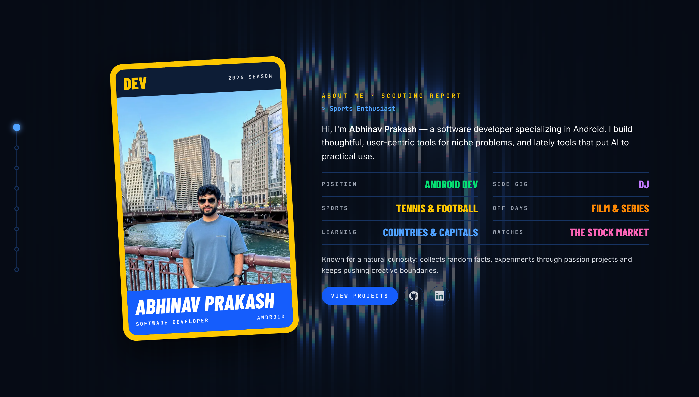

# Abhinav Prakash — Personal Website

A personal website built with Next.js, Tailwind CSS, and Firebase. Live at [abhinavprakash.dev](https://abhinavprakash.dev).

## Sections

A section nav sits along the left edge on large screens as a dot rail with a progress line; on phones and tablets it becomes a menu button that shows the current section.

**About Me** — A tilted player card with my photo, next to a "scouting report": a short bio, a typed-out list of roles, and rows for position, side gig, sports, off days, learning and what I watch. Below it, a button jumps to Projects alongside GitHub and LinkedIn links.

**Projects** — Projects I've built to solve niche, everyday problems with simple, well-architected solutions and seamless UX. A toggle splits them into:
- **Web Apps** — FIFA World Cup 26, Tennis Calendar, Concert Tracklist Finder, and World Map. Each has its own showcase layout of screenshots and recordings, numbered feature highlights, tech tags, GitHub link, and Live Site / Mac / Windows download buttons where available.
- **Mobile Apps** — Android apps (Tennis Calendar, Artist Pin), shown as phone screenshots with GitHub and Google Play links.

Arrows and project names below the showcase switch between projects; on smaller screens only the current name is shown.

**Entertainment & Music** — Movies and TV shows I've watched this year as an animated poster grid (the posters slide in as you scroll to them, with shows arriving from the last one). Below that, live Spotify data shows my top artists and top tracks with album art.

**Upcoming Fixtures** — An LED scoreboard of upcoming games for my favourite teams and players: soccer clubs (EPL, LaLiga, MLS), national teams, NBA, NFL, IPL cricket, Formula 1, and tennis. A day strip runs along the top, the next match is shown large in dot-matrix team codes lit in team colours, and the rest are listed below. Completed games are skipped automatically.

**Tennis Schedule** — A month timeline of ATP and WTA tournaments. Each tournament is a bar across its dates, coloured by tour and sized by tier (Grand Slam, 1000, 500, 250), with a line marking today and live events highlighted. Live and upcoming tournaments come first; finished ones sit behind a "Show finished" button. Shared ATP/WTA events appear as one row; WTA 125 events are hidden. Filter by All / ATP / WTA.

**Word of the Day** — Today's word from Dictionary.com shown as a dictionary entry: pronunciation, part of speech, definition, example, and a short explanation.

**Sport Question of the Day** — One multiple-choice sport question a day from The Trivia API, with an optional hint. Picking an answer reveals the right one and a short explanation, and the choice is remembered if you reload.

**Let's Connect** — Links to my GitHub, Play Store, and LinkedIn profiles.

### Across the page

- **Colour cycle:** the hero's animated lines, the falling-dot background and the page's surfaces share one colour that cross-fades through blue, violet, pink, amber and emerald every 20 seconds.
- **Reduced motion:** if your system asks for less motion, the backgrounds hold still, the typing text stops and slide-ins become fades.
- **Share preview:** links to the site show a generated preview card with the player card, name and role.

## Tech Stack

- **Framework:** Next.js 16 (App Router), React 19
- **Language:** TypeScript
- **Styling:** Tailwind CSS v4
- **Animations:** Framer Motion; the hero background is a WebGL shader
- **Fonts:** Inter, JetBrains Mono and Barlow Condensed via `next/font`
- **Database:** Firebase Firestore (movies/shows data)
- **Data sources:** ESPN (fixtures, tennis schedule), CricAPI (IPL), Jolpica Ergast (F1), Spotify Web API, Dictionary.com (Word of the Day, scraped from its page), The Trivia API (Sport Question of the Day, CC BY-NC 4.0)

## Deployment

Deployed on **Heroku** using the [heroku/nodejs](https://devcenter.heroku.com/articles/nodejs-support) buildpack. The app runs as a standard Next.js server (`npm start`) on Heroku's dynos. Environment variables (Spotify, Firebase, etc.) are configured via Heroku Config Vars in the dashboard rather than a `.env` file.

